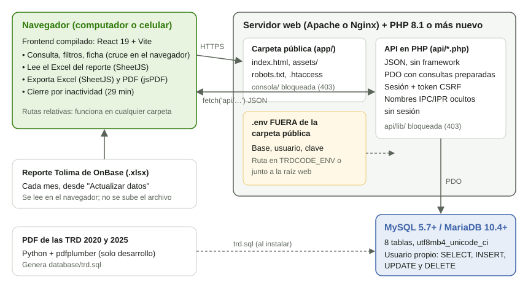

# Ficha técnica de TRDCode

**Consulta de series y subseries documentales (TRD 2020 y 2025) — SENA, Regional Tolima**

Versión 1.0.0 · noviembre de 2026. Documento para el área de sistemas.

---

## Contenido

1. [Objetivo](#1-objetivo)
2. [Arquitectura](#2-arquitectura)
3. [Tecnologías y versiones](#3-tecnologías-y-versiones)
4. [Requisitos del servidor](#4-requisitos-del-servidor)
5. [Modelo de datos](#5-modelo-de-datos)
6. [Servicios de la API](#6-servicios-de-la-api)
7. [Seguridad](#7-seguridad)
8. [Pruebas](#8-pruebas)
9. [Estructura del repositorio y del paquete](#9-estructura-del-repositorio-y-del-paquete)
10. [Mantenimiento](#10-mantenimiento)

---

## 1. Objetivo

TRDCode cruza las **Tablas de Retención Documental** (TRD 10 de 2020 y TRD 11 de 2025) de los tres centros de formación de la Regional Tolima (Industria y Construcción, Comercio y Servicios y Agropecuario La Granja) con los **expedientes registrados en OnBase**, que llegan en el "Reporte Tolima" exportado a Excel.

Permite consultar, sin usuario, cuántos expedientes hay en cada serie y subserie, con su retención, disposición final y tipos documentales; exportar a Excel o PDF e imprimir. Las personas encargadas de Gestión Documental ingresan con su cuenta para cargar el reporte mensual, volver a una carga anterior, administrar las cuentas y ver los nombres de los expedientes clasificados y reservados.

No modifica OnBase: es solo de consulta sobre una copia del reporte.

## 2. Arquitectura

- **Frontend** (carpeta pública): aplicación de una sola página, compilada a HTML, CSS y JavaScript estáticos. El cruce de expedientes con la TRD, los filtros, la búsqueda, la lectura del Excel y la generación de Excel y PDF se hacen **en el navegador**. Todas las rutas son relativas: la misma compilación funciona en cualquier carpeta del servidor.
- **API** (`api/*.php`): PHP sin framework, que responde JSON. Entrega los datos de la consulta, maneja la sesión, recibe la importación por lotes y administra las cuentas. Usa PDO con consultas preparadas.
- **Base de datos**: MySQL o MariaDB, con ocho tablas.
- **Configuración**: un archivo `.env` fuera de la carpeta pública, con los datos de conexión.
- **Extracción de las TRD**: un script de Python que se usó en el desarrollo para pasar los PDF de las TRD a `database/trd.sql`. No se necesita en el servidor.

## 3. Tecnologías y versiones

| Capa | Tecnología | Versión |
|---|---|---|
| Frontend | React | 19.3.1 |
| | Vite (compilación) | 8.3.5 |
| | SheetJS (`xlsx`): leer el reporte y exportar Excel | 0.20.3 |
| | jsPDF y jspdf-autotable: exportar PDF | 4.2.1 y 5.0.9 |
| | Fuente Work Sans (`@fontsource/work-sans`), incluida en el paquete | 5.3.0 |
| Backend | PHP sin framework, extensiones `pdo_mysql`, `mbstring` y `session` | 8.1 o más nuevo. Probado con 8.1.34, 8.2.12 y 8.4.11 |
| Base de datos | MySQL o MariaDB, InnoDB, `utf8mb4_unicode_ci` | MySQL 5.7+ o MariaDB 10.4+. Probado con MySQL 8.0.41 y MariaDB 10.4.32 |
| Servidor web | Apache 2.4 (con `.htaccess`) o Nginx con PHP-FPM | Probado con Apache 2.4 de XAMPP |
| Pruebas | Vitest; pruebas de la API en PHP; pruebas en el navegador con Edge o Chrome sin ventana (Node.js) | Vitest 5.0.5; Node.js 24 |
| Calidad | oxlint | 1.89.0 |
| Extracción de las TRD | Python con `pdfplumber` | Python 3.13, pdfplumber 0.11.10 |

El servidor **no** necesita Node.js, Composer ni Python: el frontend viene compilado.

## 4. Requisitos del servidor

| Componente | Requisito |
|---|---|
| PHP | 8.1 o superior con `pdo_mysql`, `mbstring` y `session` |
| Servidor web | Apache 2.4 con `AllowOverride` (para los `.htaccess`) o Nginx con PHP-FPM y las reglas de bloqueo equivalentes |
| Base de datos | MySQL 5.7+ o MariaDB 10.4+, con InnoDB y `utf8mb4` |
| HTTPS | Recomendado. Con HTTPS la cookie de sesión lleva `Secure` |
| Espacio | Paquete de 1,5 MB. La base crece unos 2 MB por cada carga de unos 4.000 expedientes; se guardan 3 cargas |
| Usuario de MySQL | Propio, con solo `SELECT`, `INSERT`, `UPDATE` y `DELETE` sobre la base. Nunca `root` |
| Navegadores | Edge, Chrome o Firefox actualizados, en computador o celular |

Los pasos están en la **Guía de instalación** (`INSTALACION.pdf`); para una prueba rápida en Windows con XAMPP, en la **Guía rápida de prueba** (`GUIA_RAPIDA_PRUEBA.pdf`).

## 5. Modelo de datos

Ocho tablas, todas InnoDB con `utf8mb4_unicode_ci` (`database/schema.sql`):

| Tabla | Contenido | Relaciones |
|---|---|---|
| `centros` | Los 3 centros (código `73.9226`, `73.9310`, `73.9123` y nombre) | — |
| `dependencias` | Las 9 dependencias: cada centro con su plantilla de TRD (`00.9000`, `00.9000.2`, `00.9000.4`) | `codigo_centro` → `centros` |
| `trd_registros` | Una fila por serie o subserie de cada versión de la TRD y plantilla (109): retención, disposición, soporte, clasificación, procedimiento | Llave única (versión, plantilla, serie, subserie) |
| `trd_tipos_documentales` | Los tipos documentales de cada registro, en orden (4.281) | `trd_id` → `trd_registros` (borrado en cascada) |
| `usuarios` | Cuentas de las personas encargadas: correo, nombre, hash de la contraseña, activa, contraseña temporal, último ingreso, versión de sesión | — |
| `intentos_login` | Intentos fallidos de ingreso (correo, IP, fecha), para el bloqueo | — |
| `cargas` | Cada importación del reporte: fecha del reporte, fecha de carga, quién la hizo, totales y estado (`en_proceso`, `activa`, `reemplazada`, `fallida`) | `usuario_id` → `usuarios` |
| `expedientes` | Los expedientes de cada carga: código, nombre, versión de TRD, dependencia, serie, subserie, fecha de creación, año y control de acceso | `carga_id` → `cargas` (borrado en cascada); `codigo_dependencia` → `dependencias` |

Reglas:

- La consulta usa siempre la carga **activa**. Se conservan las **dos anteriores** para poder volver a ellas; las más viejas se borran con sus expedientes.
- `codigo_subserie` vale `''` (cadena vacía), nunca `NULL`, cuando la serie no tiene subseries: así funciona la llave única.
- El cruce expediente–TRD es por (versión, plantilla de la dependencia, serie, subserie). Un código que no existe en esa versión de la TRD se muestra como "No está en la TRD" (hoy, la subserie 85.18).

## 6. Servicios de la API

Todos responden JSON `{ "ok": true, "datos": … }` o `{ "ok": false, "error": "…" }`. Los que cambian datos exigen **POST con JSON**, **sesión** y el token CSRF en la cabecera `X-CSRF-Token`; responden 405 con otro método, 401 sin sesión y 403 sin token o con una contraseña temporal pendiente.

| Servicio | Método | Sesión | Qué hace |
|---|---|---|---|
| `datos.php` | GET | No | Centros, dependencias, TRD con tipos documentales y expedientes de la carga activa. Sin sesión, los nombres IPC/IPR van ocultos |
| `sesion.php` | GET | — | Dice si hay sesión, con el nombre y el token CSRF |
| `login.php` | POST | — | Inicia la sesión (correo y contraseña), con bloqueo por intentos |
| `logout.php` | POST | Sí | Cierra la sesión |
| `cambiar_clave.php` | POST | Sí | Cambia la contraseña propia (también la temporal) |
| `mi_cuenta.php` | POST | Sí | Cambia el nombre propio |
| `cambiar_correo.php` | POST | Sí | Cambia el correo propio (pide la contraseña actual) |
| `usuarios.php` | GET | Sí | Lista de cuentas, sin hashes |
| `usuario_guardar.php` | POST | Sí | Crea una cuenta con contraseña temporal o edita otra |
| `usuario_clave_temporal.php` | POST | Sí | Pone una contraseña temporal a otra cuenta y cierra sus sesiones |
| `usuario_estado.php` | POST | Sí | Activa o desactiva otra cuenta (no la propia; siempre queda una activa) |
| `importar_iniciar.php` | POST | Sí | Abre una carga nueva `en_proceso` con la fecha del reporte (no futura) |
| `importar_lote.php` | POST | Sí | Recibe hasta 500 expedientes de la carga en curso, validados uno por uno |
| `importar_finalizar.php` | POST | Sí | Comprueba los totales, deja la carga activa y la anterior como reemplazada |
| `cargas.php` | GET | Sí | Historial de cargas guardadas |
| `restaurar_carga.php` | POST | Sí | Vuelve a una carga anterior |

La importación: el navegador lee el Excel, normaliza las filas y descarta las de otros centros; después las envía por lotes. Si se interrumpe, la carga queda `fallida` y la consulta sigue con la anterior.

## 7. Seguridad

- **Sesión.** Cookie `TRDCODE_SESION` con `HttpOnly`, `SameSite=Strict` y, con HTTPS, `Secure`, limitada a la carpeta de la aplicación. La sesión solo se abre si llega la cookie, así que los visitantes de la consulta no crean sesiones. Al ingresar se regenera el identificador. Se cierra tras **30 minutos sin peticiones** en el servidor, o si la cuenta se desactiva o se le pone una contraseña temporal.
- **Cierre por inactividad en el navegador.** A los **29 minutos** sin actividad en ninguna pestaña, la página oculta los nombres reservados y cierra la sesión.
- **CSRF.** Token por sesión en la cabecera `X-CSRF-Token` para todo lo que cambia datos.
- **Contraseñas.** De 10 a 72 caracteres, guardadas solo con `password_hash()` y verificadas con `password_verify()`. Las respuestas nunca traen contraseñas ni hashes. La primera cuenta se crea por consola (`consola/crear_primera_cuenta.php`), no por la web.
- **Bloqueo de intentos.** 15 minutos tras 5 fallos de la misma pareja correo + IP, o tras 20 fallos desde una IP con cualquier correo. El mensaje es el mismo exista o no el correo, y la respuesta tarda lo mismo.
- **Nombres reservados.** Sin sesión, `datos.php` reemplaza en la consulta SQL el nombre de los expedientes IPC, IPR o sin clasificar por "Nombre reservado (…)": el nombre real no sale del servidor. Con sesión envía los reales con `Cache-Control: private, no-store` y `Vary: Cookie`. Se controla con `OCULTAR_NOMBRES_RESERVADOS` en el `.env` (activo por defecto; desactivarlo muestra los nombres a todos y solo se hace con autorización del SENA).
- **SQL.** Consultas preparadas con PDO para todo dato externo.
- **Archivos privados.** El `.env` va fuera de la carpeta pública (ruta en `TRDCODE_ENV` o junto a la raíz web). Los `.htaccess` bloquean los archivos que empiezan con punto, `api/lib/`, `consola/` y el listado de carpetas; `database/` y `docs/` no van en la carpeta pública. `robots.txt` pide no indexar.
- **Datos personales.** El paquete no trae expedientes, reportes ni cuentas. El reporte de OnBase se lee en el navegador y no se guarda en el servidor; solo se guardan los campos necesarios de los tres centros. Los registros de error no incluyen los valores de los datos.

## 8. Pruebas

| Prueba | Qué cubre | Cómo se corre (desde la raíz del repositorio) |
|---|---|---|
| Unitarias (Vitest) | Normalización del reporte, cruce con la TRD, filtros, URL, Excel, PDF, nombres ocultos e inactividad (71) | `cd frontend` y `npm test` |
| API: sesión | Ingreso, CSRF, bloqueo, inactividad, nombres reservados con y sin sesión (58) | `php scripts/probar_auth.php [url]` |
| API: cuentas | Usuarios y Mi cuenta (64 en la base temporal) | `php scripts/probar_usuarios.php [url]` |
| API: importación | Lotes, validaciones, cargas fallidas, volver a una carga (56) | `php scripts/probar_importacion.php [url]` (base temporal) |
| Primera cuenta | Script de consola (19) | `php scripts/probar_primera_cuenta.php [url]` |
| Navegador | Inicio, ingreso, vista, menús, usuarios, exportar e imprimir, actualizar datos, instalación nueva | `node scripts/pruebas-navegador/<prueba>.mjs [url]` |

Las pruebas que crean cargas se corren contra una base temporal (`scripts/pruebas-navegador/base_temporal.php crear`), nunca contra la de producción. Las cuentas de prueba son temporales (`@trdcode.local`) y se borran al terminar; ninguna prueba imprime nombres de expedientes, correos ni contraseñas. El detalle está en `scripts/pruebas-navegador/README.md`.

## 9. Estructura del repositorio y del paquete

**Repositorio:**

| Carpeta | Contenido |
|---|---|
| `frontend/` | Código de React (`src/`), pruebas unitarias y configuración de Vite |
| `api/` | Servicios en PHP; `api/lib/` con la configuración, la conexión, la sesión y las validaciones |
| `consola/` | `crear_primera_cuenta.php` |
| `database/` | `schema.sql`, `datos_iniciales.sql`, `trd.sql`, `instalacion_completa.sql` y `migraciones/` |
| `scripts/` | Extracción de las TRD (Python), pruebas, empaquetado, generación de PDF y capturas del manual |
| `docs/` | Guías (instalación, guía rápida, manual, ficha técnica, acta de entrega) y el plan de fases |

**Paquete `TRDCode-v1.0.0.zip`** (se arma con `scripts/empaquetar.ps1`):

| Carpeta o archivo | Contenido | ¿Carpeta pública? |
|---|---|---|
| `app/` | Frontend compilado, `robots.txt`, `api/`, `consola/` y los `.htaccess` | Sí, su contenido |
| `database/` | `instalacion_completa.sql`, los tres scripts por separado y `migraciones/` | No |
| `docs/` | `INSTALACION.md` y en PDF: instalación, guía rápida, manual y ficha técnica | No |
| `.env.example` | Plantilla de la configuración, sin contraseña | No |
| `LEEME.txt` | Resumen del paquete | No |

El empaquetado se detiene si encuentra un `.env`, un Excel, expedientes, cuentas o un PDF más viejo que su documento.

## 10. Mantenimiento

**Carga mensual.** Una persona encargada exporta el "Reporte Tolima" de OnBase a Excel y lo carga desde **Actualizar datos**. La aplicación lo revisa antes de cargar (filas, expedientes por centro, descartadas, filas con problemas y códigos fuera de la TRD). Se guardan la carga en uso y las dos anteriores; si la nueva tiene errores, se vuelve a una anterior desde el historial.

**Copias de seguridad.** Con `mysqldump` de la base (por ejemplo, cada semana y antes de cada actualización), guardadas fuera del servidor web. La guía de instalación trae el comando y cómo restaurar. Las copias llevan nombres de personas: se guardan con el mismo cuidado que el reporte.

**Actualizar la aplicación.** Se reemplaza el contenido de la carpeta pública por el `app/` del paquete nuevo y se aplican, en orden y con un usuario administrador, las migraciones de `database/migraciones/` que la base no tenga (se pueden repetir sin riesgo). El `.env` no se toca.

| Migración | Qué hace |
|---|---|
| `001_usuarios.sql` | Columnas de las cuentas editables (contraseña temporal, último ingreso, cierre de sesiones) |
| `002_granja_administracion.sql` | Dependencia Administración Educativa de Agropecuario La Granja (73.9123.2) |

**Actualizar la TRD.** Si el SENA publica una versión nueva de la TRD (por ejemplo, la que trae la subserie 85.18):

1. Se ponen los PDF en `scripts/trd-pdf/` y se corre `python scripts/extraer_trd.py` (con `pdfplumber`). Las correcciones de casos especiales van en `scripts/correcciones.json`.
2. El script escribe `database/trd.sql`, que reemplaza los registros de las versiones 10 y 11. Se revisa con `docs/revision_trd.md` como guía.
3. Se arma `instalacion_completa.sql` con `node scripts/armar_instalacion_completa.mjs`, se corren las pruebas y se arma un paquete nuevo.
4. En el servidor, con un usuario administrador, se importa el `trd.sql` nuevo. Los expedientes no se tocan: el cruce se recalcula en el navegador.

Una versión de TRD con otro número (por ejemplo, 12) necesita además cambios en el código (selector de versión y normalización del reporte).

**Cuentas.** Si nadie puede ingresar, `consola/crear_primera_cuenta.php` reactiva o crea una cuenta, solo cuando no hay ninguna activa.
