# Manual de usuario de TRDCode

**Consulta de series y subseries documentales — SENA, Regional Tolima, Centros de Formación**

Versión 1.0.0 · noviembre de 2026.

---

## Contenido

1. [Qué es TRDCode](#1-qué-es-trdcode)
2. [Cómo abrir la aplicación](#2-cómo-abrir-la-aplicación)
3. [La pantalla de inicio](#3-la-pantalla-de-inicio)
4. [La consulta y sus filtros](#4-la-consulta-y-sus-filtros)
5. [Cómo leer los resultados](#5-cómo-leer-los-resultados)
6. [La ficha de una serie o subserie](#6-la-ficha-de-una-serie-o-subserie)
7. [Exportar a Excel y PDF, e imprimir](#7-exportar-a-excel-y-pdf-e-imprimir)
8. [Compartir una consulta](#8-compartir-una-consulta)
9. [En el celular](#9-en-el-celular)
10. [Ingresar: solo para las personas encargadas](#10-ingresar-solo-para-las-personas-encargadas)
11. [Nombres reservados, con y sin sesión](#11-nombres-reservados-con-y-sin-sesión)
12. [Mi cuenta](#12-mi-cuenta)
13. [Usuarios](#13-usuarios)
14. [Actualizar datos](#14-actualizar-datos)
15. [Ejercicios con respuesta](#15-ejercicios-con-respuesta)
16. [Si algo no funciona](#16-si-algo-no-funciona)
17. [Glosario](#17-glosario)

---

## 1. Qué es TRDCode

TRDCode reúne en un solo lugar dos cosas que antes había que cruzar a mano:

- **Las Tablas de Retención Documental (TRD)** de los centros de formación: cada serie y subserie con su tiempo de retención, su disposición final y sus tipos documentales.
- **Los expedientes que existen en OnBase**: cuántos hay en cada serie y subserie, con su código, nombre y fecha de creación. Salen del "Reporte Tolima" que se exporta de OnBase.

Cubre los tres centros de formación de la Regional Tolima, cada uno con tres dependencias:

| Centro | Dependencias |
|---|---|
| Industria y Construcción | Subdirección, Administración Educativa y Formación Profesional Integral |
| Comercio y Servicios | Subdirección, Administración Educativa y Formación Profesional Integral |
| Agropecuario La Granja | Subdirección, Administración Educativa y Formación Profesional Integral |

Y las dos versiones de la TRD:

| Versión | Vigencia | Cuándo se usa |
|---|---|---|
| **TRD 11** | 2025 (vigente) | Expedientes creados con la tabla actual. Viene marcada al abrir la aplicación. |
| **TRD 10** | 2020 | Expedientes creados con la tabla anterior. Los códigos cambian entre versiones: por ejemplo, Historias académicas es la serie **37** en la TRD 11 y la serie **35** en la TRD 10. |

**Consultar no necesita usuario.** Cualquier persona con la dirección puede buscar, ver fichas, exportar e imprimir. Solo las personas encargadas de Gestión Documental **ingresan** con su cuenta, para cargar el reporte nuevo cada mes, administrar las cuentas y ver los nombres reservados.

Desde la aplicación no se crean, modifican ni borran expedientes: eso se hace en OnBase.

---

## 2. Cómo abrir la aplicación

1. Abra el navegador (Edge, Chrome o Firefox), en el computador o en el celular.
2. Escriba la dirección que le dio el área de sistemas, por ejemplo `https://servidor/trdcode/`. En una instalación de prueba en un solo equipo suele ser `http://localhost/TRDCode/`.
3. Espere un momento a que carguen los datos.

La fecha **"Datos al …"** dice de qué día es el reporte de OnBase cargado. Los expedientes creados después de esa fecha aparecerán cuando se cargue un reporte nuevo (sección 14).

---

## 3. La pantalla de inicio

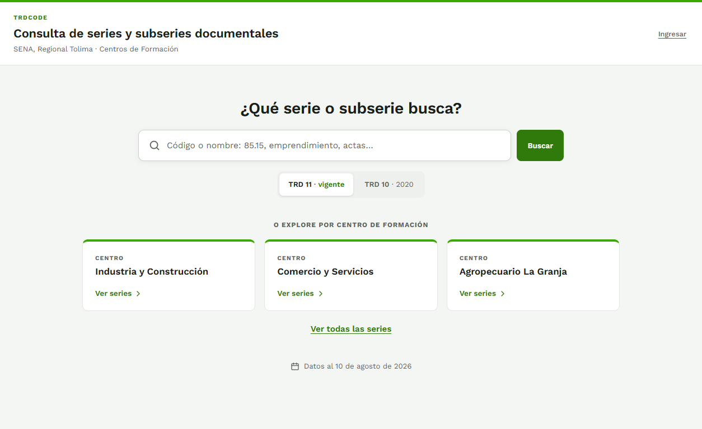

Es lo primero que se ve. Tiene:

| Parte | Para qué sirve |
|---|---|
| **¿Qué serie o subserie busca?** | Escriba un código o un nombre (por ejemplo `85.15`, `emprendimiento` o `actas`) y pulse **Buscar** o **Enter**. |
| **TRD 11 · vigente / TRD 10 · 2020** | Elige la versión de la tabla de retención para la búsqueda. |
| **Tarjetas de los centros** | **Ver series** abre la consulta de ese centro. |
| **Ver todas las series** | Abre la consulta de los tres centros. |
| **Datos al …** | La fecha del reporte de OnBase cargado. |
| **Ingresar** (arriba a la derecha) | Solo para las personas encargadas (sección 10). |

Para volver al inicio desde cualquier pantalla, haga clic en el título **TRDCode · Consulta de series y subseries documentales**.

---

## 4. La consulta y sus filtros

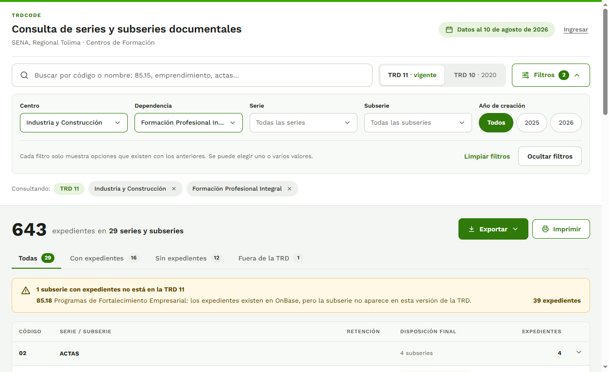

Arriba están el **buscador**, la **versión de la TRD** y el botón **Filtros**; debajo, el **panel de filtros** y la fila **Consultando:**. Más abajo, el total, las pestañas y la tabla (sección 5).

### 4.1 Elegir la versión de la TRD

Haga clic en **TRD 11 · vigente** o en **TRD 10 · 2020**. Al cambiar de versión se borran la serie y la subserie elegidas, porque los códigos no son los mismos entre versiones. El centro, la dependencia, el año y la búsqueda se conservan.

### 4.2 Centro, dependencia, serie y subserie

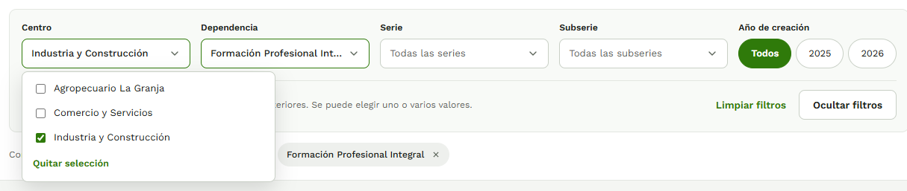

1. Haga clic en una lista (por ejemplo, **Centro**). Se abre con una casilla por opción.
2. Marque una o varias casillas. La consulta se actualiza al instante.
3. Para cerrar la lista, haga clic fuera de ella o pulse **Esc**. **Quitar selección** desmarca todo.

Los filtros van **en cascada**: cada lista muestra solo las opciones que existen según las anteriores (**Centro → Dependencia → Serie → Subserie**). Al cambiar un filtro se borran los que dependen de él:

| Si cambia… | Se borran… |
|---|---|
| Centro | Dependencia, Serie y Subserie |
| Dependencia | Serie y Subserie |
| Serie | Subserie |

La lista **Dependencia** muestra el tipo de dependencia (por ejemplo, "Formación Profesional Integral"), que vale para todos los centros elegidos. En **Agropecuario La Granja**, las series de **Administración Educativa** aparecen "Sin expedientes" mientras el reporte no traiga expedientes suyos.

### 4.3 Año de creación

Hay un botón por cada año con expedientes en la consulta. Marque uno o varios; **Todos** quita el filtro. Con un año elegido, el total y la tabla cuentan solo los expedientes creados ese año.

### 4.4 Buscar

Escriba en el buscador: la búsqueda se aplica sola, un instante después de dejar de escribir. Encuentra:

- el **código** de una serie o subserie: `85.15`, `37`;
- el **nombre** de una serie o subserie: `emprendimiento`, `actas`;
- el **código** de un expediente: `2023EX-000672`;
- el **nombre** de un expediente. Sin sesión, solo los de información pública (sección 11).

No importan las tildes ni las mayúsculas: `historias` encuentra "HISTORIAS ACADÉMICAS".

Si no hay resultados en la versión elegida pero sí en la otra, aparece un aviso con un botón para cambiar:

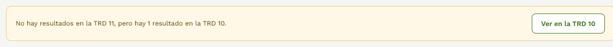

### 4.5 Ver y quitar lo que se está consultando

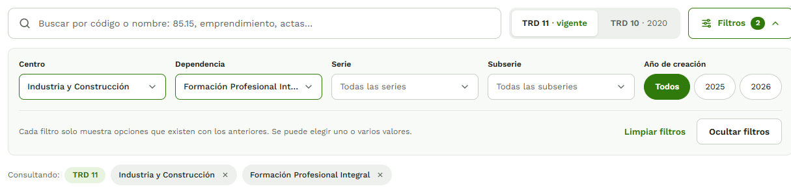

La fila **Consultando:** muestra una etiqueta por cada cosa elegida. La verde es la versión de la TRD y siempre está. Las demás tienen una **×** para quitar ese filtro.

- **Limpiar filtros**: quita todos los filtros y la búsqueda (se conserva la versión de la TRD).
- **Ocultar filtros**: cierra el panel para dejar más espacio. Los filtros siguen aplicados; el número verde del botón **Filtros** dice cuántos hay.

---

## 5. Cómo leer los resultados

### 5.1 El total y las pestañas

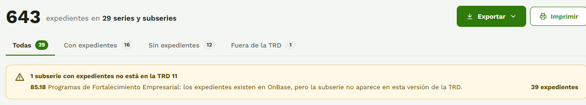

El número grande es la cantidad de expedientes de la consulta, y al lado, cuántas series y subseries abarca. Las pestañas dividen la tabla:

| Pestaña | Muestra |
|---|---|
| **Todas** | Todas las series y subseries de la consulta. |
| **Con expedientes** | Las que tienen al menos un expediente. |
| **Sin expedientes** | Las que existen en la TRD pero no tienen expedientes. |
| **Fuera de la TRD** | Las que tienen expedientes con un código que no existe en esa versión de la TRD. |

### 5.2 El recuadro amarillo: la subserie 85.18 y otros códigos fuera de la TRD

Aparece cuando hay expedientes en OnBase con un código de serie o subserie que **no existe** en la versión de la TRD elegida. Hoy pasa con la **85.18 Programas de Fortalecimiento Empresarial**: en OnBase sus expedientes están marcados como TRD 11, pero la TRD 11 que tiene la aplicación no trae esa subserie. Lo más probable es que se haya agregado en una actualización de la TRD posterior; Gestión Documental está consiguiendo esa versión.

TRDCode muestra esos expedientes **con el nombre que trae OnBase y sin reclasificarlos**, en la pestaña **Fuera de la TRD** y con la etiqueta **"No está en la TRD"**. Si aparece otro código en este recuadro, conviene revisarlo: puede ser un error de clasificación en OnBase o una subserie nueva.

### 5.3 La tabla

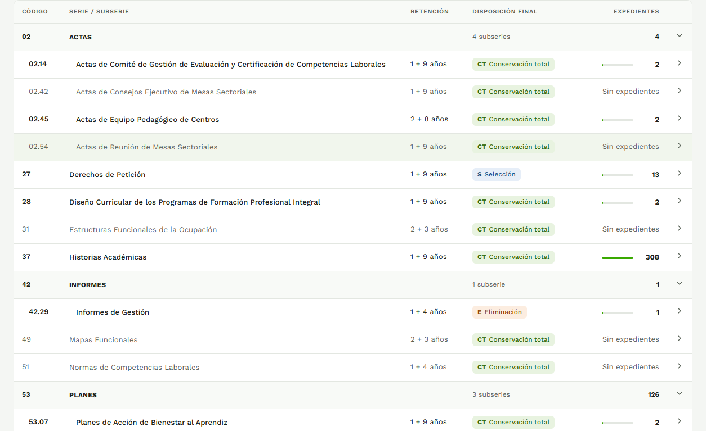

| Columna | Qué dice |
|---|---|
| **Código** | Código de la serie (`27`) o de la subserie (`02.14`). |
| **Serie / subserie** | Nombre como aparece en la TRD. |
| **Retención** | Años en archivo de gestión + años en archivo central: **"1 + 9 años"** es 1 año en gestión y 9 en archivo central. |
| **Disposición final** | Qué se hace con los documentos al cumplir la retención. |
| **Expedientes** | Cuántos hay, con una barra que compara con la que más tiene en la consulta. |

**Disposición final:**

| Etiqueta | Significa |
|---|---|
| **CT** Conservación total (verde) | Se conservan permanentemente. |
| **S** Selección (azul) | Se conserva una muestra y el resto se elimina. |
| **E** Eliminación (naranja) | Se eliminan al terminar la retención. |
| **MT** Medio tecnológico (gris) | Solo en la TRD 11. |
| **M** Microfilmar, **D** Digitalizar (gris) | Solo en la TRD 10. Pueden ir junto a otra (por ejemplo, **CT** y **D**). |

En la columna **Expedientes** puede aparecer un número con su barra, **Sin expedientes** (la serie está en la TRD pero no tiene expedientes en el reporte) o **Sin expedientes en el período** (tiene, pero no en los años elegidos). Las filas sin expedientes se ven en gris.

**Series con subseries.** Aparecen como una fila de grupo con fondo gris y el nombre en mayúsculas (por ejemplo, **02 ACTAS**), que dice cuántas subseries tiene y suma sus expedientes. Haga clic en ella para plegarla o desplegarla.

**Varias dependencias.** Si la consulta abarca más de una, la tabla se divide en secciones con una franja verde (Subdirección, Administración Educativa y Formación Profesional Integral). Con varios centros, los expedientes de cada serie se suman.

---

## 6. La ficha de una serie o subserie

Haga clic en **cualquier parte de una fila** (no en las de grupo) para abrir su ficha, en un panel a la derecha:

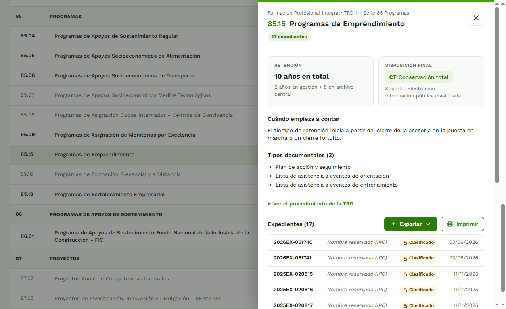

- **Encabezado**: la dependencia, la versión de la TRD y la serie; debajo, el código, el nombre y la cantidad de expedientes.
- **Retención**: el total de años y cómo se reparte entre gestión y archivo central.
- **Disposición final**: la etiqueta de color, el **soporte** (papel o electrónico) y la **clasificación** de la información que define la TRD.
- **Cuándo empieza a contar**: el hecho que inicia el tiempo de retención, como lo dice la TRD 11 (las TRD de 2020 no lo traen).
- **Tipos documentales**: los documentos que forman el expediente, en el orden de la TRD. Si son más de 20, el enlace **"Ver los N tipos documentales"** muestra todos.
- **Ver el procedimiento de la TRD**: despliega el texto completo.
- **Expedientes**: cada uno con su **código**, su **nombre**, su **control de acceso** (Público, Clasificado o Reservado) y su **fecha de creación**, del más reciente al más antiguo, en páginas de 50. Con varios centros, debajo del nombre aparece el centro.

En la ficha están también **Exportar** e **Imprimir**, solo para esa serie o subserie (sección 7).

Para cerrarla: el botón **×**, la tecla **Esc** o un clic en la parte oscura, fuera del panel.

Si abre una fila **"No está en la TRD"** (como la 85.18), la ficha no tiene retención, disposición ni tipos documentales, porque la TRD no los define: muestra un aviso y el listado de expedientes.

---

## 7. Exportar a Excel y PDF, e imprimir

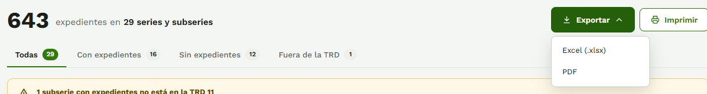

Junto al total y dentro de cada ficha hay un botón **Exportar** (con **Excel (.xlsx)** y **PDF**) y un botón **Imprimir**. Todos llevan **lo mismo que se ve**:

| Desde | Qué lleva |
|---|---|
| El total | Las series y subseries de la **pestaña que se está viendo**, con los filtros de la consulta. |
| La ficha | Solo esa serie o subserie, con su detalle y todos sus expedientes. |

**Excel.** Se guarda en **Descargas** como `TRDCode_consulta_AAAA-MM-DD.xlsx` (desde la ficha, `TRDCode_ficha_<código>_AAAA-MM-DD.xlsx`), con tres hojas:

| Hoja | Contenido |
|---|---|
| **Series y subseries** | Dependencia, códigos y nombres de serie y subserie, retención en gestión y en archivo central, disposición final, estado y cantidad de expedientes. |
| **Expedientes** | Centro, dependencia, códigos de serie y subserie, código y nombre del expediente, fecha de creación y control de acceso. |
| **Filtros** | La versión de la TRD, lo elegido en cada filtro, la búsqueda, de qué pestaña o ficha sale, la fecha de los datos y la de descarga. |

**PDF.** Tiene el mismo nombre que el Excel, con `.pdf`. Lleva el título, la fecha de los datos, los filtros, el total y la tabla como en pantalla; desde la ficha, además, su detalle y sus expedientes. Cada página lleva encabezado y "Página N de M".

**Imprimir** abre la ventana de impresión del navegador con una versión limpia, sin botones ni menús. Con la ficha abierta se imprime solo la ficha, con todos sus expedientes (no solo los 50 de la página). Desde ahí también se puede **guardar como PDF**.

Los nombres de los expedientes clasificados y reservados salen igual que en pantalla (sección 11).

---

## 8. Compartir una consulta

La dirección del navegador guarda los filtros, la búsqueda y la ficha abierta. Por ejemplo:

```
https://servidor/trdcode/#centros=73.9226&dependencias=00.9000.4&ficha=11|00.9000.4|85|85.15
```

Si copia esa dirección y la envía, o la abre de nuevo (o recarga con **F5**), la aplicación vuelve a la misma consulta con la misma ficha abierta. La pestaña elegida no se guarda: siempre vuelve a **Todas**. Los botones **Atrás** y **Adelante** del navegador también funcionan.

---

## 9. En el celular

TRDCode se adapta a la pantalla del celular:

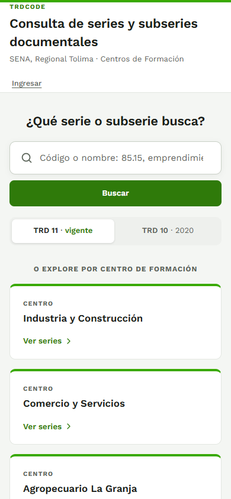

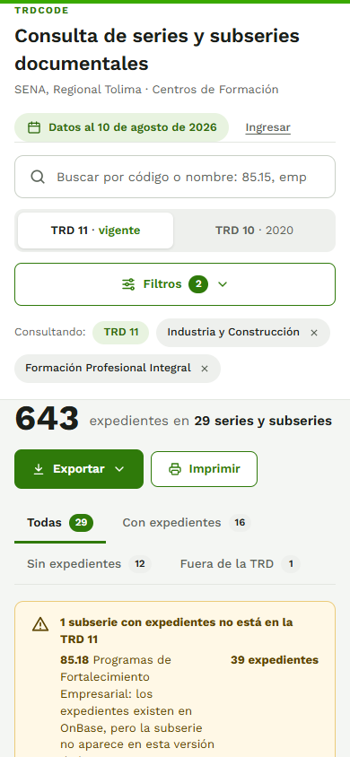

- Los filtros quedan plegados detrás del botón **Filtros** para dejar espacio a los resultados.
- La tabla se acomoda al ancho, y la ficha ocupa toda la pantalla.
- Exportar, Imprimir, Ingresar y las pantallas de las personas encargadas funcionan igual.

---

## 10. Ingresar: solo para las personas encargadas

Las personas encargadas de Gestión Documental tienen una cuenta para **actualizar los datos**, **administrar las cuentas** y **ver los nombres reservados**. Consultar no necesita cuenta.

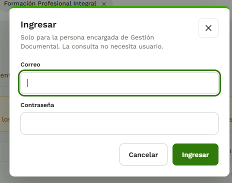

1. Pulse **Ingresar**, arriba a la derecha.
2. Escriba su **correo** y su **contraseña**, y pulse **Ingresar**.
3. Arriba aparece su nombre. Al hacer clic en él se abre el menú:

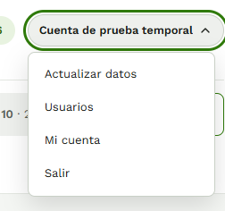

| Opción | Para qué |
|---|---|
| **Actualizar datos** | Cargar el reporte nuevo de OnBase (sección 14). |
| **Usuarios** | Crear y administrar las cuentas (sección 13). |
| **Mi cuenta** | Cambiar su nombre, su correo o su contraseña (sección 12). |
| **Salir** | Cerrar la sesión. |

**Si se equivoca de contraseña.** Tras 5 intentos fallidos seguidos, la cuenta queda bloqueada **15 minutos** en ese equipo. Espere y vuelva a intentarlo, o pida a otra persona encargada que le ponga una contraseña temporal (sección 13).

**Contraseña temporal.** Si su cuenta es nueva o alguien le puso una contraseña temporal, al ingresar aparece la ventana **"Cambie su contraseña temporal"**. No se puede cerrar: escriba la temporal y una nueva que solo usted conozca (mínimo 10 caracteres). Mientras no la cambie, no puede hacer nada más.

**Cierre de la sesión.** La sesión se cierra al pulsar **Salir**, o sola tras **29 minutos sin actividad** (ver la sección 11).

---

## 11. Nombres reservados, con y sin sesión

Los expedientes de información pública **clasificada (IPC)** o **reservada (IPR)** llevan un candado en el listado. Su nombre suele traer datos de personas, por eso:

| Quién | Qué ve |
|---|---|
| **Cualquier persona, sin ingresar** | **"Nombre reservado (IPC)"** o **"Nombre reservado (IPR)"** en lugar del nombre. El nombre real **no sale del servidor**: tampoco aparece en el Excel ni en el PDF, ni se puede encontrar con el buscador. El código, la fecha y el control de acceso sí se ven. |
| **Las personas encargadas, con la sesión iniciada** | Los **nombres reales**, en pantalla, en el Excel, en el PDF y en la impresión. |

Al **salir**, los nombres vuelven a ocultarse de inmediato. Si nadie usa la aplicación durante **29 minutos** (ni el mouse, ni el teclado, ni la pantalla táctil), la sesión se cierra sola, los nombres se ocultan y aparece este aviso:

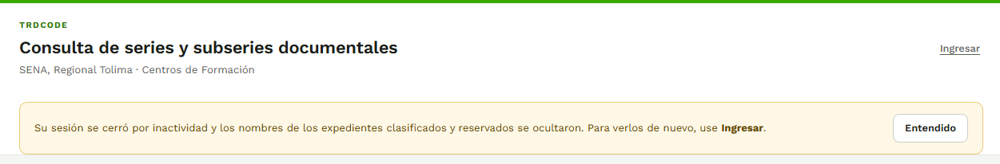

Para verlos de nuevo, pulse **Ingresar**. Aun así:

- No deje la sesión abierta en un computador compartido: use **Salir** al terminar.
- Los archivos exportados con la sesión iniciada llevan los nombres reales: guárdelos y compártalos con el mismo cuidado que el reporte de OnBase.

---

## 12. Mi cuenta

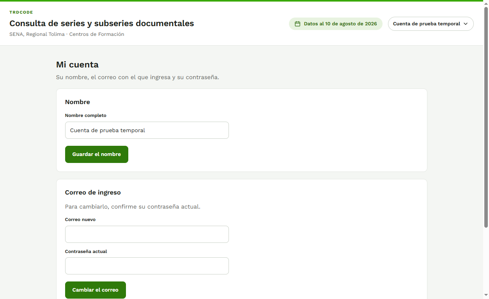

En el menú de su nombre, **Mi cuenta** tiene tres partes:

- **Nombre**: corrija su nombre completo y pulse **Guardar el nombre**.
- **Correo de ingreso**: escriba el correo nuevo y su **contraseña actual**, y pulse **Cambiar el correo**. Desde ese momento ingresa con el correo nuevo.
- **Contraseña**: **Cambiar la contraseña** pide la actual y la nueva dos veces (mínimo 10 caracteres, distinta de la actual). Al cambiarla se cierran sus otras sesiones abiertas, por ejemplo en otro equipo.

---

## 13. Usuarios

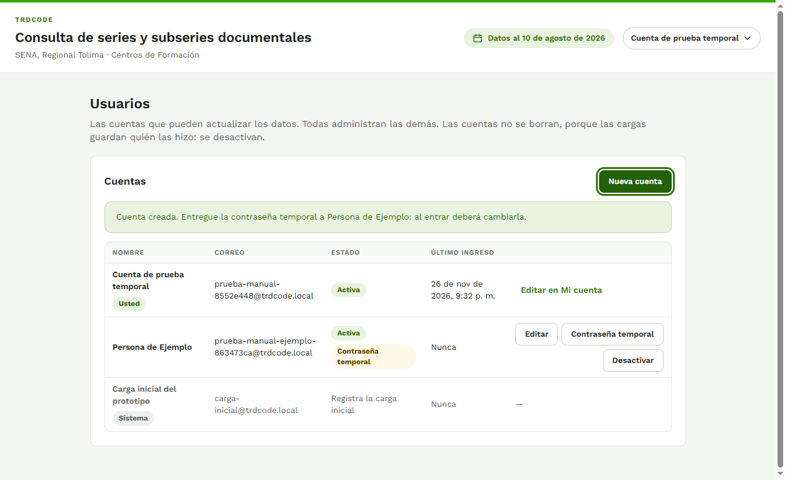

**Usuarios** muestra las cuentas que pueden actualizar los datos, con su estado y su último ingreso. **Todas las cuentas activas pueden administrar las demás.** La suya aparece como **Usted** (se edita en **Mi cuenta**). La cuenta **Sistema** es técnica: registra la carga inicial y no tiene acciones.

**Crear una cuenta.** Pulse **Nueva cuenta**, escriba el nombre completo, el correo y una **contraseña temporal** dos veces (mínimo 10 caracteres), y pulse **Crear la cuenta**. Entregue la contraseña temporal a la persona por un medio seguro: al ingresar por primera vez deberá cambiarla.

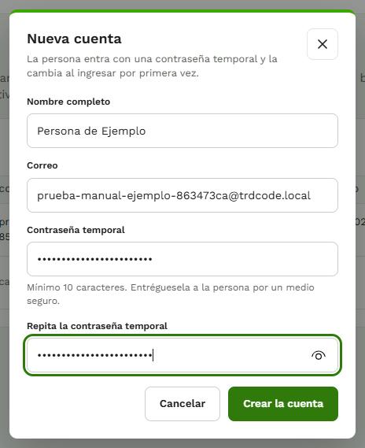

Con las otras cuentas puede:

| Botón | Qué hace |
|---|---|
| **Editar** | Corrige el nombre o el correo. |
| **Contraseña temporal** | Le pone una contraseña temporal (por ejemplo, si olvidó la suya). Sus sesiones abiertas se cierran y deberá cambiarla al ingresar. |
| **Desactivar** | La persona ya no puede ingresar y sus sesiones se cierran. Sus cargas se conservan. |
| **Activar** | Devuelve el acceso a una cuenta desactivada. |

Las cuentas **no se borran**, porque cada carga guarda quién la hizo: se desactivan. Nadie puede desactivar su propia cuenta, y siempre queda al menos una cuenta activa.

---

## 14. Actualizar datos

Cada mes, una persona encargada carga el **Reporte Tolima** exportado de OnBase. La consulta sigue mostrando los datos anteriores hasta que la carga termina.

En el menú de su nombre, elija **Actualizar datos**:

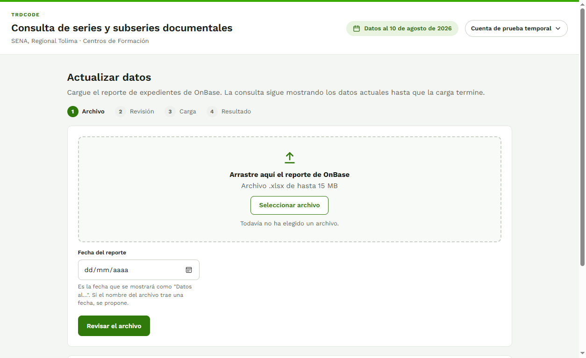

**Paso 1. Archivo.** Arrastre el Excel del reporte a la zona punteada, o pulse **Seleccionar archivo**. Debe ser un `.xlsx` de hasta 15 MB. Revise la **Fecha del reporte**: es la que se mostrará como "Datos al…". Si el nombre del archivo trae una fecha, se propone sola; no puede ser posterior a hoy. Pulse **Revisar el archivo**.

**Paso 2. Revisión.** La aplicación lee el archivo en su propio navegador (todavía no carga nada) y muestra:

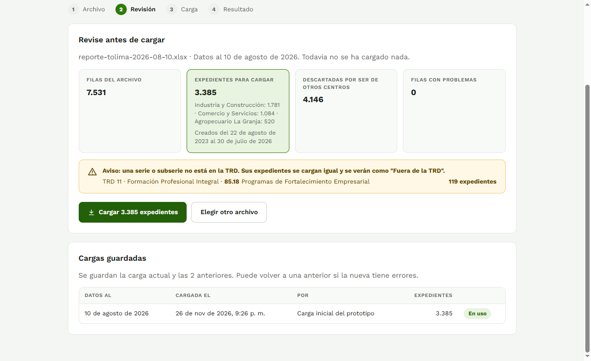

| Dato | Significa |
|---|---|
| **Filas del archivo** | Todas las filas del reporte. |
| **Expedientes para cargar** | Los de los tres centros, por centro, con el rango de fechas de creación. |
| **Descartadas por ser de otros centros** | El reporte trae toda la Regional; TRDCode solo usa los tres centros. |
| **Filas con problemas** | Filas que no se pueden cargar (sin código, código repetido, fecha inválida…). Al abrir la lista se ve el número de fila, el código y el motivo, para corregirlas en OnBase. |

Si alguna serie o subserie no está en la TRD (como la 85.18), aparece un aviso amarillo: esos expedientes **se cargan igual** y se verán como "Fuera de la TRD".

Si todo está bien, pulse **Cargar N expedientes**. Si no, **Elegir otro archivo**.

**Pasos 3 y 4. Carga y resultado.** Una barra muestra el avance. Al terminar aparece **"Se cargaron N expedientes"** con la fecha de los datos, y la consulta ya muestra el reporte nuevo. Si algo falla a mitad de camino, la consulta sigue con los datos anteriores y se puede intentar otra vez.

### 14.1 Cargas guardadas: volver a una anterior

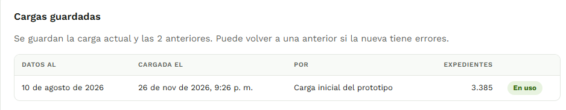

Debajo está el historial: la carga **En uso** y las **2 anteriores**, con la fecha de los datos, cuándo se cargó, quién la cargó y cuántos expedientes trae. Si la carga nueva tiene errores, pulse **Volver a esta carga** en una anterior y confirme: la consulta vuelve a esos datos y la que estaba en uso queda guardada como anterior.

---

## 15. Ejercicios con respuesta

Sirven para practicar. Las respuestas corresponden al reporte del **10 de agosto de 2026**; con otro reporte cargado, las cantidades cambian. Antes de cada uno, pulse **Limpiar filtros**.

### Ejercicio 1. ¿Cuántos expedientes de Historias académicas tiene Formación Profesional de Industria y Construcción?

1. Deje marcada **TRD 11 · vigente**.
2. En **Centro**, marque **Industria y Construcción**; en **Dependencia**, **Formación Profesional Integral**.
3. Busque la fila **37 Historias Académicas**.

**Respuesta:** **308** expedientes. El total de la consulta es **643 expedientes en 29 series y subseries**.

### Ejercicio 2. ¿Cuánto tiempo se guardan los Programas de Emprendimiento y qué pasa después?

1. Con la consulta del ejercicio 1, haga clic en la fila **85.15 Programas de Emprendimiento**.

**Respuesta:** **10 años en total** (2 en gestión + 8 en archivo central) y luego **Conservación total**. Tiene **17 expedientes**, todos de información pública clasificada: sin sesión, con el nombre reservado.

2. Pulse **Exportar → Excel (.xlsx)** dentro de la ficha: el archivo trae esa subserie y sus 17 expedientes.

### Ejercicio 3. ¿Qué expedientes no corresponden a la TRD vigente?

1. Con la **TRD 11** y sin filtros, mire el recuadro amarillo o abra la pestaña **Fuera de la TRD**.

**Respuesta:** la subserie **85.18 Programas de Fortalecimiento Empresarial**, con **119 expedientes** entre los tres centros (39 de ellos en Formación Profesional de Industria y Construcción).

### Ejercicio 4. ¿Dónde está el expediente 2023EX-000672?

1. Con la **TRD 11**, escriba `2023EX-000672` en el buscador.
2. Aparece el aviso **"No hay resultados en la TRD 11, pero hay 1 resultado en la TRD 10"**. Pulse **Ver en la TRD 10**.

**Respuesta:** en la subserie **03.02 Resoluciones** de la **Subdirección de Comercio y Servicios**, en la TRD 2020, con disposición **CT** y **D** (conservación total y digitalizar).

### Ejercicio 5. ¿Tiene Comercio y Servicios historias académicas?

1. Con la **TRD 11**, marque el centro **Comercio y Servicios** y busque `historias`. La serie **37 Historias Académicas** aparece **Sin expedientes**.
2. Cambie a **TRD 10 · 2020** (el centro y la búsqueda se conservan).

**Respuesta:** en la TRD 2020 aparece la subserie **35.01 Historias Académicas Formación Titulada** con **1 expediente**. Por eso conviene revisar las dos versiones.

---

## 16. Si algo no funciona

| Qué pasa | Qué hacer |
|---|---|
| Aparece **"No se pudieron leer los datos"** o la página sale en blanco | Recargue con **F5**. Si sigue igual, avise al área de sistemas: puede estar apagado el servidor o la base de datos. |
| Se ven las series, pero **sin expedientes** | Todavía no se ha cargado ningún reporte. Una persona encargada debe hacerlo (sección 14). |
| No encuentro una serie o subserie | Revise la **versión de la TRD** (los códigos cambian entre la 10 y la 11), la fila **Consultando:** y la **pestaña**. Para empezar de cero, **Limpiar filtros**. |
| Busco el nombre de un expediente y no aparece | Sin sesión, el nombre de los expedientes clasificados y reservados está oculto. Busque por su **código**, o ingrese con su cuenta. |
| Los expedientes más recientes no aparecen | Mire la fecha **"Datos al…"**: los creados después llegarán con el próximo reporte. |
| **"Correo o contraseña incorrectos"** | Revise mayúsculas y el correo. Tras 5 intentos, espere 15 minutos o pida una contraseña temporal a otra persona encargada. |
| La sesión se cerró sola | Pasaron 29 minutos sin actividad. Vuelva a **Ingresar**. |
| El archivo del reporte no se acepta | Debe ser el `.xlsx` exportado de OnBase, de hasta 15 MB, con una fecha que no sea posterior a hoy. |
| El Excel o el PDF no se descargan | Revise la carpeta **Descargas** y si el navegador muestra un aviso de descarga bloqueada. |

---

## 17. Glosario

| Término | Significado |
|---|---|
| **TRD** | Tabla de Retención Documental: qué series y subseries produce cada dependencia, cuánto tiempo se guardan y qué se hace con ellas al final. |
| **Serie** | Conjunto de documentos de una misma función (por ejemplo, 27 Derechos de Petición). |
| **Subserie** | División de una serie (por ejemplo, 02.14, dentro de 02 Actas). |
| **Tipo documental** | Cada documento que forma un expediente (por ejemplo, "Lista de asistencia"). |
| **Expediente** | Conjunto de documentos de un mismo asunto, con un código como `2025EX-020815`. |
| **AG / AC** | Archivo de gestión (mientras se usan) y archivo central (después, hasta cumplir la retención). |
| **CT, S, E** | Disposición final: conservación total, selección y eliminación. |
| **MT** | Medio tecnológico (TRD 11). |
| **M, D** | Microfilmar y digitalizar (TRD 10). |
| **IPU, IPC, IPR** | Información pública, pública clasificada y pública reservada. |
| **OnBase** | El sistema donde el SENA registra los expedientes. El reporte que usa TRDCode sale de ahí. |
| **Plantilla** | La TRD de un tipo de dependencia: 00.9000 (Subdirección), 00.9000.2 (Administración Educativa) y 00.9000.4 (Formación Profesional Integral). Cada centro la aplica con su código (por ejemplo, 73.9226.4). |
| **Carga** | Cada vez que se sube un reporte de OnBase. Se guardan la actual y las 2 anteriores. |
