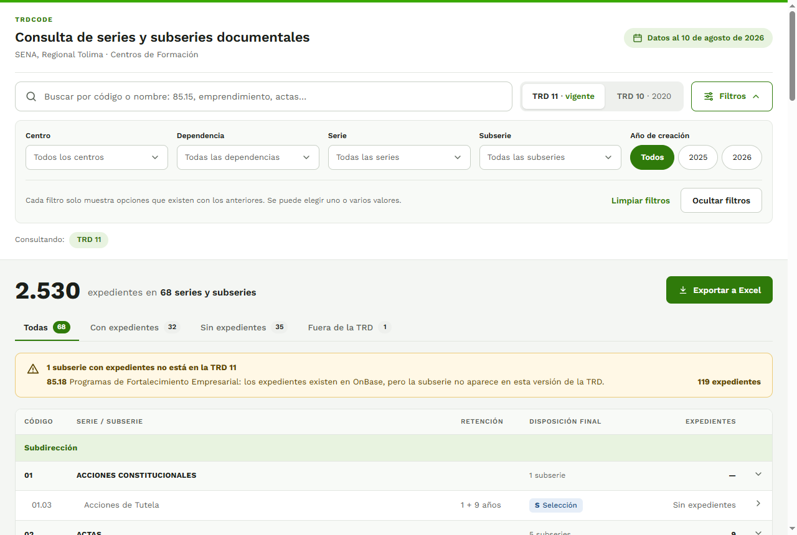
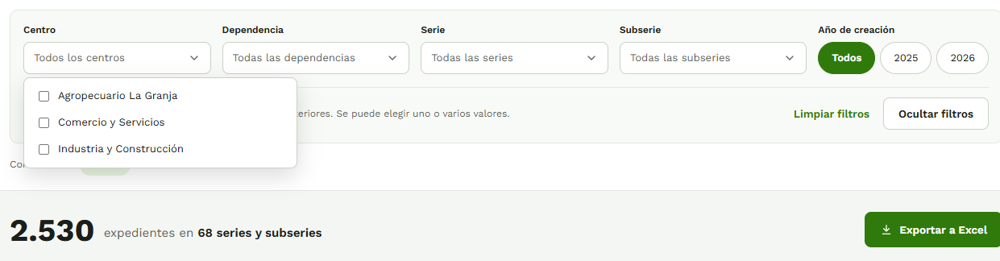
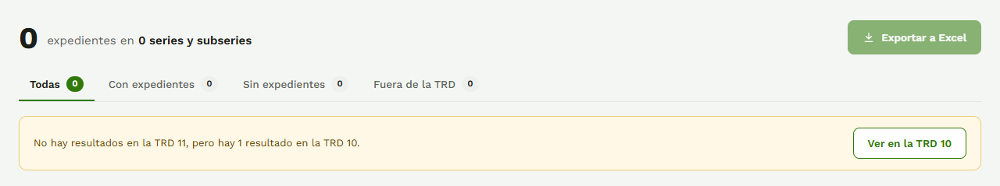
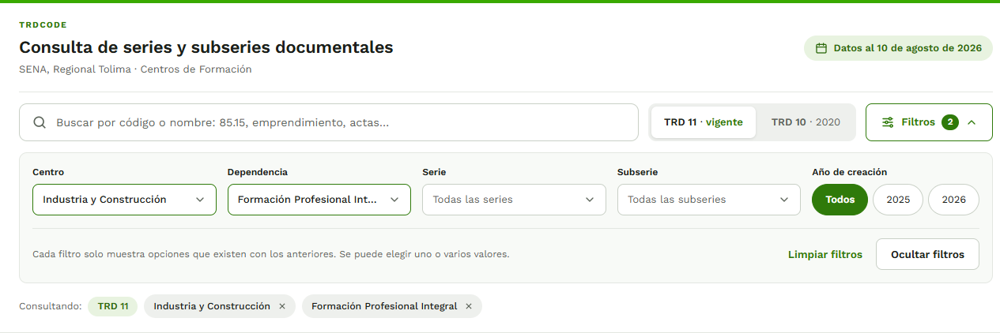
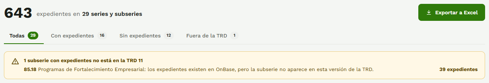
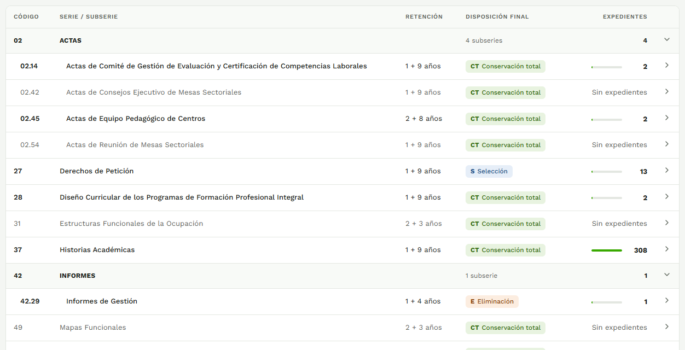
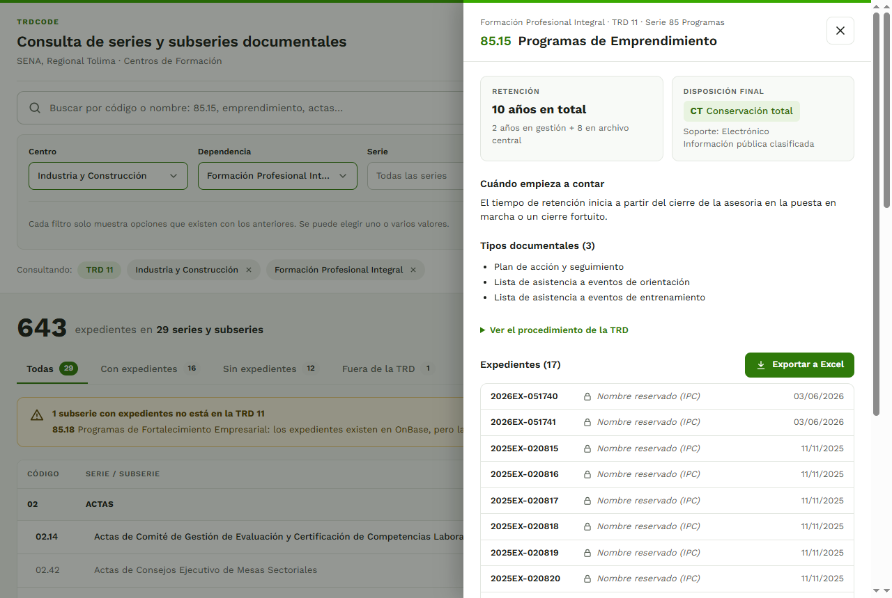

# Manual de usuario de TRDCode

**Consulta de series y subseries documentales — SENA, Regional Tolima, Centros de Formación**

Versión del prototipo: noviembre de 2026. Datos del reporte de OnBase del 10 de agosto de 2026.

---

## Contenido

1. [Qué es TRDCode](#1-qué-es-trdcode)
2. [Cómo abrir la aplicación](#2-cómo-abrir-la-aplicación)
3. [Las partes de la pantalla](#3-las-partes-de-la-pantalla)
4. [Cómo hacer una consulta](#4-cómo-hacer-una-consulta)
5. [Cómo leer la tabla de resultados](#5-cómo-leer-la-tabla-de-resultados)
6. [La ficha de una serie o subserie](#6-la-ficha-de-una-serie-o-subserie)
7. [Exportar a Excel](#7-exportar-a-excel)
8. [Compartir una consulta](#8-compartir-una-consulta)
9. [Ejercicios con respuesta](#9-ejercicios-con-respuesta)
10. [Si algo no funciona](#10-si-algo-no-funciona)
11. [Lo que el prototipo todavía no hace](#11-lo-que-el-prototipo-todavía-no-hace)
12. [Glosario](#12-glosario)

---

## 1. Qué es TRDCode

TRDCode muestra, en un solo lugar, dos cosas que hasta ahora había que cruzar a mano:

- **Las Tablas de Retención Documental (TRD)** de los centros de formación: cada serie y subserie con su tiempo de retención, su disposición final y sus tipos documentales.
- **Los expedientes que existen en OnBase**: cuántos hay en cada serie y subserie, con su código, nombre y fecha de creación.

Cubre los tres centros de formación de la Regional Tolima y sus dependencias:

| Centro | Dependencias |
|---|---|
| Industria y Construcción | Subdirección, Administración Educativa y Formación Profesional Integral |
| Comercio y Servicios | Subdirección, Administración Educativa y Formación Profesional Integral |
| Agropecuario La Granja | Subdirección y Formación Profesional Integral |

Y las dos versiones de la TRD:

| Versión | Vigencia | Cuándo se usa |
|---|---|---|
| **TRD 11** | 2025 (vigente) | Expedientes creados con la tabla actual. Viene marcada al abrir la aplicación. |
| **TRD 10** | 2020 | Expedientes creados con la tabla anterior. Los códigos cambian entre versiones: por ejemplo, Historias académicas es la serie **37** en la TRD 11 y la serie **35** en la TRD 10. |

**Es solo de consulta.** Desde la aplicación no se crean, modifican ni borran expedientes.

---

## 2. Cómo abrir la aplicación

1. Encienda el equipo donde está instalada y verifique en el **XAMPP Control Panel** que **Apache** y **MySQL** estén en verde.
2. Abra el navegador (Edge, Chrome o Firefox) y escriba en la barra de direcciones:

   ```
   http://localhost/TRDCode/
   ```

3. Espere unos segundos a que carguen los datos. Arriba a la derecha debe aparecer **"Datos al 10 de agosto de 2026"**: es la fecha del reporte de OnBase que tiene cargado la aplicación. Los expedientes creados después de esa fecha no aparecen.

No hace falta usuario ni contraseña para consultar.

---

## 3. Las partes de la pantalla



De arriba hacia abajo:

| Parte | Para qué sirve |
|---|---|
| **Encabezado** | Nombre de la aplicación y, a la derecha, la fecha de los datos. |
| **Buscador** | Encuentra series, subseries o expedientes por código o por nombre. |
| **TRD 11 · vigente / TRD 10 · 2020** | Elige la versión de la tabla de retención. Solo se ve una a la vez. |
| **Botón "Filtros"** | Abre y cierra el panel de filtros. El número verde dice cuántos filtros hay elegidos. |
| **Panel de filtros** | Centro, Dependencia, Serie, Subserie y Año de creación. Al abrir la aplicación está abierto. |
| **Consultando:** | Etiquetas con todo lo que se está consultando. Cada una tiene una **×** para quitarla. |
| **Total** | El número grande es la cantidad de expedientes de la consulta, y al lado, cuántas series y subseries abarca. |
| **Exportar a Excel** | Descarga lo que se está viendo. |
| **Pestañas** | Todas, Con expedientes, Sin expedientes y Fuera de la TRD. |
| **Recuadro amarillo** | Avisa si hay expedientes con un código que no existe en la TRD. |
| **Tabla** | Las series y subseries, agrupadas como en la TRD. |

Al abrir, la aplicación muestra la **TRD 11 de los tres centros**: **2.530 expedientes en 68 series y subseries**.

---

## 4. Cómo hacer una consulta

Los filtros funcionan **en cascada**: cada uno muestra solo las opciones que existen según los anteriores. El orden es **TRD → Centro → Dependencia → Serie → Subserie**, más el **Año**.

### 4.1 Elegir la versión de la TRD

Haga clic en **TRD 11 · vigente** o en **TRD 10 · 2020**. La opción elegida queda en blanco y resaltada.

Al cambiar de versión se borran la serie y la subserie elegidas, porque los códigos no son los mismos entre versiones. El centro, la dependencia y el año se conservan.

### 4.2 Elegir centro, dependencia, serie o subserie



1. Haga clic en la lista (por ejemplo, **Centro**). Se abre con una casilla por opción.
2. Marque una o varias casillas. La consulta se actualiza al instante.
3. Para cerrar la lista, haga clic fuera de ella o pulse **Esc**.

Cuando hay una opción marcada, la lista muestra su nombre (por ejemplo, "Industria y Construcción"); con varias, muestra cuántas ("2 centros"). Para desmarcar todo, abra la lista y pulse **Quitar selección**.

**Al cambiar un filtro se borran los que dependen de él:**

| Si cambia… | Se borran… |
|---|---|
| Centro | Dependencia, Serie y Subserie |
| Dependencia | Serie y Subserie |
| Serie | Subserie |

La lista **Dependencia** muestra el tipo de dependencia ("Formación Profesional Integral"), que vale para todos los centros elegidos. **Agropecuario La Granja no tiene Administración Educativa**, por eso esa opción no aparece cuando solo está elegido ese centro.

En **Serie** y **Subserie** cada opción lleva su código: "37 · Historias Académicas", "85.15 · Programas de Emprendimiento".

### 4.3 Filtrar por año de creación

En **Año de creación** hay un botón por cada año que tiene expedientes en la consulta (en la TRD 11: 2025 y 2026; en la TRD 10: 2023, 2024 y 2025).

- Haga clic en un año para marcarlo; puede marcar varios.
- **Todos** quita el filtro de año.

Con un año elegido, el total y la tabla cuentan solo los expedientes creados ese año.

### 4.4 Buscar por código o nombre

Escriba en el buscador. La búsqueda se aplica sola, un instante después de dejar de escribir. Encuentra:

- el **código** de una serie o subserie: `85.15`, `37`;
- el **nombre** de una serie o subserie: `emprendimiento`, `actas`;
- el **código** de un expediente: `2023EX-000672`;
- el **nombre** de un expediente (solo los de información pública; ver la sección 6.4).

No importan las tildes ni las mayúsculas: `historias` encuentra "HISTORIAS ACADÉMICAS".

Si no hay resultados en la versión elegida pero sí en la otra, aparece un aviso con un botón para cambiar de versión:



### 4.5 Ver y quitar lo que se está consultando



La fila **Consultando:** muestra una etiqueta por cada cosa elegida. La etiqueta verde es la versión de la TRD y siempre está. Las demás tienen una **×**: al pulsarla se quita ese filtro (con la misma regla de la cascada de la sección 4.2).

### 4.6 Limpiar u ocultar los filtros

- **Limpiar filtros** (al pie del panel): quita todos los filtros y la búsqueda. Se conserva la versión de la TRD.
- **Ocultar filtros**: cierra el panel para dejar más espacio a la tabla. Los filtros siguen aplicados. Para volver a abrirlo, pulse el botón **Filtros**.

---

## 5. Cómo leer la tabla de resultados

### 5.1 El total y las pestañas



El número grande es la cantidad de expedientes de la consulta. Las pestañas dividen las series y subseries, y el número de cada una dice cuántas hay:

| Pestaña | Muestra |
|---|---|
| **Todas** | Todas las series y subseries de la consulta. |
| **Con expedientes** | Las que tienen al menos un expediente. |
| **Sin expedientes** | Las que existen en la TRD pero no tienen expedientes. |
| **Fuera de la TRD** | Las que tienen expedientes con un código que no existe en esa versión de la TRD. |

### 5.2 El recuadro amarillo: códigos que no están en la TRD

Aparece cuando hay expedientes en OnBase con un código de serie o subserie que no existe en la versión de la TRD elegida. Por ejemplo:

> **85.18** Programas de Fortalecimiento Empresarial: los expedientes existen en OnBase, pero la subserie no aparece en esta versión de la TRD. **39 expedientes**

La aplicación muestra esos expedientes con el nombre que trae OnBase, **sin reclasificarlos**. Si aparece este aviso, conviene revisarlo con Gestión Documental: puede ser un error de clasificación en OnBase o una subserie que se creó después de la TRD.

### 5.3 Las columnas



| Columna | Qué dice |
|---|---|
| **Código** | Código de la serie (`27`) o de la subserie (`02.14`). |
| **Serie / subserie** | Nombre como aparece en la TRD. |
| **Retención** | Años en archivo de gestión + años en archivo central. **"1 + 9 años"** es 1 año en gestión y 9 en archivo central. |
| **Disposición final** | Qué se hace con los documentos al cumplir la retención (ver la tabla siguiente). |
| **Expedientes** | Cuántos expedientes hay, con una barra que compara con la serie que más tiene en la consulta. |

**Colores de la disposición final:**

| Etiqueta | Significa |
|---|---|
| **CT** Conservación total (verde) | Se conservan permanentemente. |
| **S** Selección (azul) | Se conserva una muestra y el resto se elimina. |
| **E** Eliminación (naranja) | Se eliminan al terminar la retención. |
| **MT** Medio tecnológico (gris) | Solo en la TRD 11. |
| **M** Microfilmar, **D** Digitalizar (gris) | Solo en la TRD 10. Pueden ir junto a otra: por ejemplo, 03.02 Resoluciones lleva **CT** y **D**. |

**Lo que puede aparecer en la columna Expedientes:**

| Texto | Significa |
|---|---|
| Un número con su barra | Cantidad de expedientes de esa serie o subserie en la consulta. |
| **Sin expedientes** | La serie o subserie está en la TRD, pero no tiene ningún expediente en el reporte. |
| **Sin expedientes en el período** | Tiene expedientes, pero ninguno en los años elegidos. |
| **No está en la TRD** (en la columna de disposición) | El código no existe en esa versión de la TRD (sección 5.2). |

Las filas sin expedientes se ven en gris; las que tienen expedientes, en negro.

### 5.4 Series con subseries

Una serie que tiene subseries aparece como una **fila de grupo** con fondo gris y su nombre en mayúsculas (por ejemplo, **02 ACTAS**). En la columna de disposición dice cuántas subseries tiene ("4 subseries"), y a la derecha, el total de expedientes de todas ellas (o "—" si no tiene ninguno).

- Haga clic en la fila del grupo para **plegarla** (ocultar sus subseries) o **desplegarla**. La flecha de la derecha indica si está abierta (hacia abajo) o plegada (hacia la derecha).

Las series sin subseries (por ejemplo, **27 Derechos de Petición**) son una sola fila con sus propios datos.

### 5.5 Varias dependencias a la vez

Si la consulta abarca más de una dependencia, la tabla se divide en secciones con una franja verde: **Subdirección**, **Administración Educativa** y **Formación Profesional Integral**. Cada dependencia tiene su propia TRD, así que una misma serie puede aparecer en más de una sección.

Si eligió varios centros, los expedientes de cada serie o subserie se suman entre ellos.

---

## 6. La ficha de una serie o subserie

Haga clic en **cualquier parte de una fila** (no en las filas de grupo) para abrir su ficha. Se abre un panel a la derecha:



### 6.1 Encabezado

Arriba dice la dependencia, la versión de la TRD y la serie a la que pertenece; debajo, el código y el nombre (por ejemplo, **85.15 Programas de Emprendimiento**).

### 6.2 Retención y disposición final

| Tarjeta | Contenido |
|---|---|
| **Retención** | El total de años ("10 años en total") y cómo se reparte: "2 años en gestión + 8 en archivo central". |
| **Disposición final** | La etiqueta de color, el **soporte** (papel o electrónico) y la **clasificación** de la información. |

La clasificación es la que define la TRD para toda la subserie. Cada expediente puede tener su propio control de acceso, que se ve en el listado.

### 6.3 Cuándo empieza a contar, tipos documentales y procedimiento

- **Cuándo empieza a contar**: el hecho que inicia el tiempo de retención, tal como lo dice la TRD (por ejemplo, "El tiempo de retención inicia a partir del cierre de la asesoría…"). Las TRD de 2020 no traen esta frase, así que en ellas no aparece.
- **Tipos documentales**: los documentos que forman el expediente, en el orden de la TRD. Cuando la TRD los agrupa, aparecen bajo un subtítulo en verde (por ejemplo, en los contratos: "Modalidad Licitación Pública"). Si son más de 20, se ven los primeros 20 y un enlace **"Ver los N tipos documentales"**.
- **Ver el procedimiento de la TRD**: despliega el texto completo del procedimiento.

### 6.4 Listado de expedientes

Muestra cada expediente con su **código**, su **nombre** y su **fecha de creación**, del más reciente al más antiguo, en páginas de 50 (botones **Anteriores** y **Siguientes**). Si la consulta tiene varios centros, debajo del nombre aparece el centro.

**Nombres reservados.** Los expedientes con información pública **clasificada (IPC)** o **reservada (IPR)** muestran un candado y el texto **"Nombre reservado (IPC)"** o **"Nombre reservado (IPR)"** en lugar del nombre. Es una protección de datos personales: el nombre real no sale del servidor, así que tampoco aparece en el Excel ni se puede encontrar con el buscador. El código y la fecha sí se ven.

### 6.5 Cerrar la ficha

Use cualquiera de estas tres formas:

- el botón **×** de arriba a la derecha;
- la tecla **Esc**;
- un clic en la parte oscura de la pantalla, fuera del panel.

### 6.6 Ficha de un código que no está en la TRD

Si abre una fila **"No está en la TRD"** (como la 85.18), la ficha no tiene retención, disposición ni tipos documentales, porque la TRD no los define. Muestra un aviso y el listado de expedientes.

---

## 7. Exportar a Excel

Hay dos botones **Exportar a Excel**:

| Botón | Qué descarga |
|---|---|
| Junto al total | Las series y subseries de la **pestaña que se está viendo**, con todos sus expedientes. Desde la pestaña **Todas**, descarga toda la consulta. |
| Dentro de la ficha | Solo esa serie o subserie y sus expedientes. |

El archivo se guarda en la carpeta **Descargas** con el nombre **`TRDCode-AAAA-MM-DD.xlsx`** (la fecha del día en que se descarga) y trae tres hojas:

| Hoja | Columnas |
|---|---|
| **Series y subseries** | Dependencia, Código serie, Serie, Código subserie, Subserie, Retención AG (años), Retención AC (años), Disposición final, Estado y Expedientes. |
| **Expedientes** | Centro, Dependencia, Código serie, Código subserie, Código expediente, Nombre del expediente, Fecha de creación y Control de acceso. |
| **Filtros** | La versión de la TRD, los centros, dependencias, series, subseries y años elegidos, la búsqueda, la fecha de los datos y la fecha y hora de descarga. |

Los nombres reservados también salen como "Nombre reservado (IPC)" o "(IPR)" en el Excel.

---

## 8. Compartir una consulta

La dirección del navegador guarda los filtros, la búsqueda y la ficha abierta. Por ejemplo:

```
http://localhost/TRDCode/#centros=73.9226&dependencias=00.9000.4&ficha=11|00.9000.4|85|85.15
```

Si copia esa dirección y la abre de nuevo (o la recarga con **F5**), la aplicación vuelve a la misma consulta con la misma ficha abierta. La pestaña elegida no se guarda: siempre vuelve a **Todas**.

Mientras la aplicación esté instalada solo en este equipo, la dirección funciona solo aquí. Cuando el SENA la instale en sus servidores, se podrá compartir con otras personas.

---

## 9. Ejercicios con respuesta

Sirven para practicar. Antes de cada uno, pulse **Limpiar filtros**.

### Ejercicio 1. ¿Cuántos expedientes de Historias académicas tiene Formación Profesional de Industria y Construcción?

1. Deje marcada **TRD 11 · vigente**.
2. En **Centro**, marque **Industria y Construcción**.
3. En **Dependencia**, marque **Formación Profesional Integral**.
4. Busque la fila **37 Historias Académicas** en la tabla.

**Respuesta:** **308** expedientes. El total de la consulta es **643 expedientes en 29 series y subseries**.

### Ejercicio 2. ¿Cuánto tiempo se guardan los Programas de Emprendimiento y qué pasa después?

1. Con la consulta del ejercicio 1, haga clic en la fila **85.15 Programas de Emprendimiento**.
2. Lea las tarjetas de la ficha.

**Respuesta:** **10 años en total** (2 en gestión + 8 en archivo central) y luego **Conservación total**. Tiene **17 expedientes**, todos con el nombre reservado (información pública clasificada).

3. Pulse **Exportar a Excel** dentro de la ficha: el archivo trae esa subserie y sus 17 expedientes.

### Ejercicio 3. ¿Qué expedientes no corresponden a la TRD vigente?

1. Con la **TRD 11** y sin filtros, mire el recuadro amarillo, o abra la pestaña **Fuera de la TRD**.

**Respuesta:** la subserie **85.18 Programas de Fortalecimiento Empresarial**, con **119 expedientes** entre los tres centros (39 de ellos en Formación Profesional de Industria y Construcción).

### Ejercicio 4. ¿Dónde está el expediente 2023EX-000672?

1. Con la **TRD 11**, escriba `2023EX-000672` en el buscador.
2. Aparece el aviso **"No hay resultados en la TRD 11, pero hay 1 resultado en la TRD 10"**. Pulse **Ver en la TRD 10**.

**Respuesta:** está en la subserie **03.02 Resoluciones** de la **Subdirección de Comercio y Servicios**, en la TRD 2020, con disposición **CT** y **D** (conservación total y digitalizar). Para ver el expediente, abra la ficha de 03.02.

### Ejercicio 5. ¿Tiene Comercio y Servicios historias académicas?

1. Con la **TRD 11**, marque el centro **Comercio y Servicios** y busque `historias`.
2. La serie **37 Historias Académicas** aparece, pero **Sin expedientes**.
3. Cambie a **TRD 10 · 2020** (el centro y la búsqueda se conservan).

**Respuesta:** en la TRD 2020 aparece la subserie **35.01 Historias Académicas Formación Titulada** con **1 expediente**, creado en 2025. Es un ejemplo de por qué conviene revisar las dos versiones.

---

## 10. Si algo no funciona

| Qué pasa | Qué hacer |
|---|---|
| Aparece **"No se pudieron cargar los datos"** | Abra el XAMPP Control Panel y verifique que **MySQL** y **Apache** estén en verde. Luego recargue la página con **F5**. Si sigue igual, avise a la persona que instaló la aplicación. |
| La página sale en blanco | Revise que **Apache** esté encendido y que la dirección termine en `/TRDCode/`. |
| Se ven las series, pero **0 expedientes** | Falta cargar los expedientes en la base de datos. Avise a la persona que instaló la aplicación. |
| No encuentro una serie o subserie | Revise: la **versión de la TRD** (los códigos cambian entre la 10 y la 11), los **filtros activos** en la fila "Consultando:" y la **pestaña** elegida. Si quiere empezar de cero, pulse **Limpiar filtros**. |
| Busco el nombre de un expediente y no aparece | Si el expediente es clasificado o reservado, su nombre no se puede buscar (sección 6.4). Busque por su **código**. |
| El Excel no se descarga | Revise la carpeta **Descargas** y si el navegador muestra un aviso de descarga bloqueada arriba a la derecha. |
| Los expedientes más recientes no aparecen | La aplicación muestra el reporte del **10 de agosto de 2026**. Los expedientes creados después aparecerán cuando se cargue un reporte nuevo. |

---

## 11. Lo que el prototipo todavía no hace

Estas funciones están en el plan del proyecto y llegarán en las siguientes versiones:

- **Actualizar los datos** con un reporte nuevo de OnBase desde la pantalla (con inicio de sesión de la persona encargada de Gestión Documental).
- Ver el **historial de cargas** y volver a una carga anterior.
- **Exportar a PDF** e **imprimir**.

Mientras tanto, los datos se actualizan con ayuda de la persona que instaló la aplicación.

---

## 12. Glosario

| Término | Significado |
|---|---|
| **TRD** | Tabla de Retención Documental: dice qué series y subseries produce cada dependencia, cuánto tiempo se guardan y qué se hace con ellas al final. |
| **Serie** | Conjunto de documentos de una misma función (por ejemplo, 27 Derechos de Petición). |
| **Subserie** | División de una serie (por ejemplo, 02.14 Actas de Comité de Gestión de Evaluación y Certificación de Competencias Laborales, dentro de 02 Actas). |
| **Tipo documental** | Cada documento que forma un expediente (por ejemplo, "Lista de asistencia"). |
| **Expediente** | Conjunto de documentos de un mismo asunto, con un código como `2025EX-020815`. |
| **AG** | Archivo de gestión: donde se guardan los documentos mientras se usan. |
| **AC** | Archivo central: donde se guardan después, hasta cumplir la retención. |
| **CT, S, E** | Disposición final: conservación total, selección y eliminación. |
| **MT** | Medio tecnológico (TRD 11). |
| **M, D** | Microfilmar y digitalizar (TRD 10). |
| **IPU, IPC, IPR** | Información pública, pública clasificada y pública reservada. |
| **OnBase** | El sistema donde el SENA registra los expedientes. El reporte que usa TRDCode sale de ahí. |
| **Plantilla** | La TRD de un tipo de dependencia: 00.9000 (Subdirección), 00.9000.2 (Administración Educativa) y 00.9000.4 (Formación Profesional Integral). Cada centro la aplica con su propio código (por ejemplo, 73.9226.4). |
